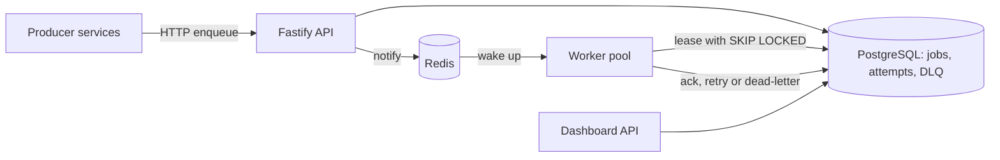

# PulseQueue

A production-style distributed job queue for Node.js services, built in TypeScript with Fastify, PostgreSQL and Redis. Producers enqueue jobs over an HTTP API, workers lease and execute them with retries and exponential backoff, failed jobs go to a dead-letter queue, and a dashboard API reports queue health.

This project is being built milestone by milestone. See [ROADMAP.md](ROADMAP.md) for the plan and progress.

