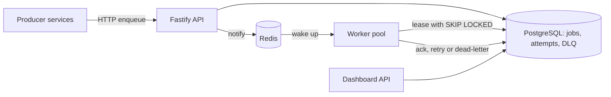
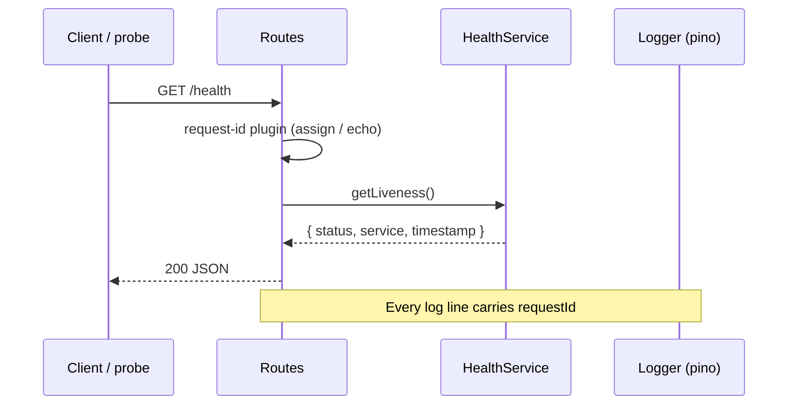

# PulseQueue

A production-style distributed job queue for Node.js services, built in TypeScript with Fastify, PostgreSQL and Redis. Producers enqueue jobs over an HTTP API, workers lease and execute them with retries and exponential backoff, failed jobs go to a dead-letter queue, and a dashboard API reports queue health.

This project is being built milestone by milestone. See [ROADMAP.md](ROADMAP.md) for the plan and progress.



## Features

### Done (Milestone 0)

- TypeScript + Fastify HTTP skeleton with a layered architecture
- Zod-validated configuration (fail-fast on bad env)
- Structured JSON logging with pino and per-request IDs
- Typed domain errors and consistent JSON error responses
- `GET /health` (liveness) and `GET /ready` (readiness)
- ESLint, Prettier, Vitest, multi-stage Dockerfile, docker-compose, GitHub Actions CI

### Planned

- Job model, enqueue API, idempotency keys (M1)
- Workers with `SELECT … FOR UPDATE SKIP LOCKED`, retries, heartbeats (M2)
- Dead-letter queue and replay (M3)
- Delayed / cron scheduling (M4)
- Redis pub/sub wake-ups and cached stats (M5)
- API keys, multi-tenancy, rate limits (M6)
- Dashboard API, Prometheus, OpenTelemetry (M7)
- Load / chaos testing and capacity notes (M8)

## Architecture (request flow — health)



Routes stay thin: they call services, never own business rules or data access. Repositories (stubs in M0) will own SQL. Domain types and errors live under `src/domain/`.

## Design decisions (Milestone 0)

| Decision                                                            | Why                                                          | Trade-off                                                   |
| ------------------------------------------------------------------- | ------------------------------------------------------------ | ----------------------------------------------------------- |
| Layered folders (`routes` → `services` → `repositories` → `domain`) | Keeps HTTP concerns out of business logic; easy to test      | Slightly more boilerplate for tiny stubs                    |
| Zod for env config                                                  | Fail fast before listen; typed `Env` everywhere              | Requires DATABASE_URL / REDIS_URL even before they are used |
| pino + `x-request-id`                                               | Production JSON logs; correlate a request across layers      | Pretty transport only in development                        |
| Typed `AppError` hierarchy                                          | Consistent `{ error: { code, message, details? } }` bodies   | Call sites must throw domain errors, not raw `Error`        |
| Postgres as source of truth (planned) + Redis notify (planned)      | Durable leases with `SKIP LOCKED`; Redis avoids busy-polling | Two moving parts; Redis optional until M5                   |
| Vitest + Fastify `inject`                                           | Fast unit/smoke tests without opening a port                 | Integration tests with real Postgres come in M2             |

## Project layout

```
src/
  app.ts              # Fastify build (no listen)
  server.ts           # process entry: loadEnv → listen → shutdown
  config/             # zod env schema
  domain/             # AppError hierarchy, job type stubs
  lib/                # logger, error mapper
  plugins/            # request-id, central error handler
  routes/             # /health, /ready
  services/           # HealthService (thin)
  repositories/       # stubs for M1+
tests/                # vitest unit + route smoke tests
```

## Setup

### Prerequisites

- Node.js 20+
- Docker + Docker Compose (optional, for full stack)

### Local (API only)

```bash
cp .env.example .env
npm ci
npm run dev
# → http://127.0.0.1:3000/health
```

Required env vars are documented in `.env.example`. Config validation fails the process immediately if anything required is missing or invalid.

### Docker Compose (app + Postgres 16 + Redis 7)

```bash
docker compose up --build
```

Postgres and Redis become healthy before the app starts. The app image is a multi-stage Node 20 build that runs as a non-root user.

### Scripts

| Script              | Purpose             |
| ------------------- | ------------------- |
| `npm run dev`       | tsx watch server    |
| `npm run build`     | compile to `dist/`  |
| `npm start`         | run compiled server |
| `npm run lint`      | ESLint              |
| `npm run typecheck` | `tsc --noEmit`      |
| `npm test`          | Vitest (run once)   |
| `npm run format`    | Prettier write      |

CI runs `lint`, `typecheck`, and `test` on Node 20 (see `.github/workflows/ci.yml`).

## API

### `GET /health`

Liveness probe. Does **not** check Postgres or Redis.

```json
{
  "status": "ok",
  "service": "pulsequeue",
  "timestamp": "2026-10-19T04:00:00.000Z"
}
```

### `GET /ready`

Readiness probe. Milestone 0: returns ready once the app has booted. Later milestones will also require DB and Redis connectivity (HTTP 503 when not ready).

```json
{
  "status": "ready",
  "checks": { "app": "ok" },
  "timestamp": "2026-10-19T04:00:00.000Z"
}
```

Both endpoints echo `x-request-id` (inbound header or a generated UUID).

### Errors

All errors use a consistent shape:

```json
{
  "error": {
    "code": "NOT_FOUND",
    "message": "Route GET /missing not found"
  }
}
```

## Scaling notes (stub)

- Horizontal: multiple API replicas behind a load balancer; workers scale independently.
- Leasing (M2): `SKIP LOCKED` lets many workers pull without contending on the same row.
- Redis (M5): pub/sub wake-ups cut idle poll load; Postgres remains the lease authority.
- Capacity numbers and k6 results land in Milestone 8.

## License

MIT (to be confirmed when the public repo is finalized).
